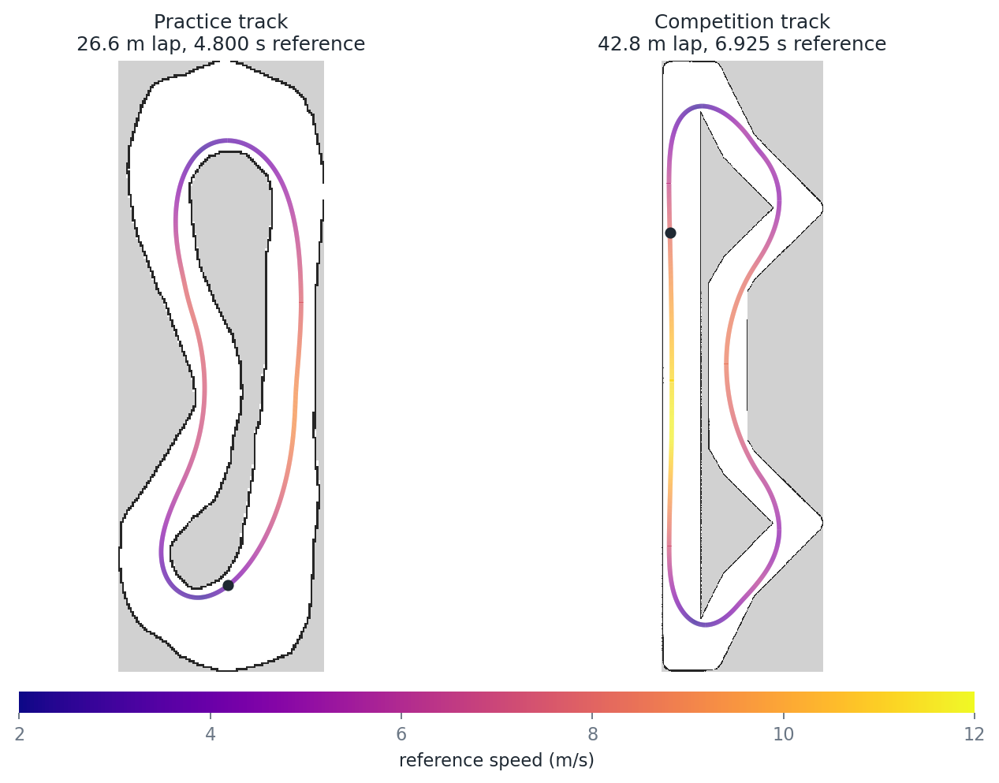
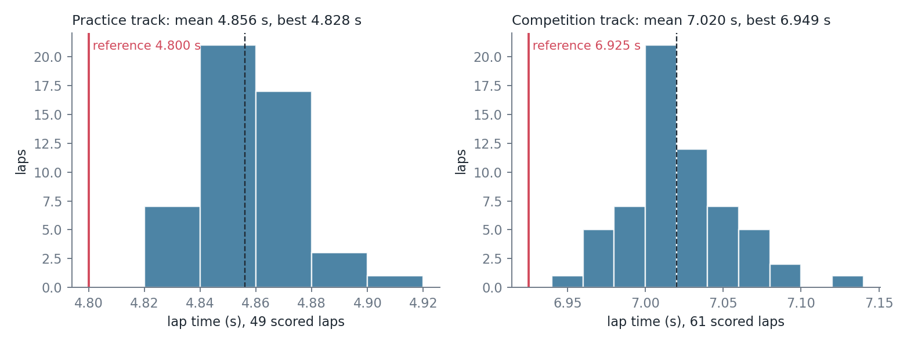
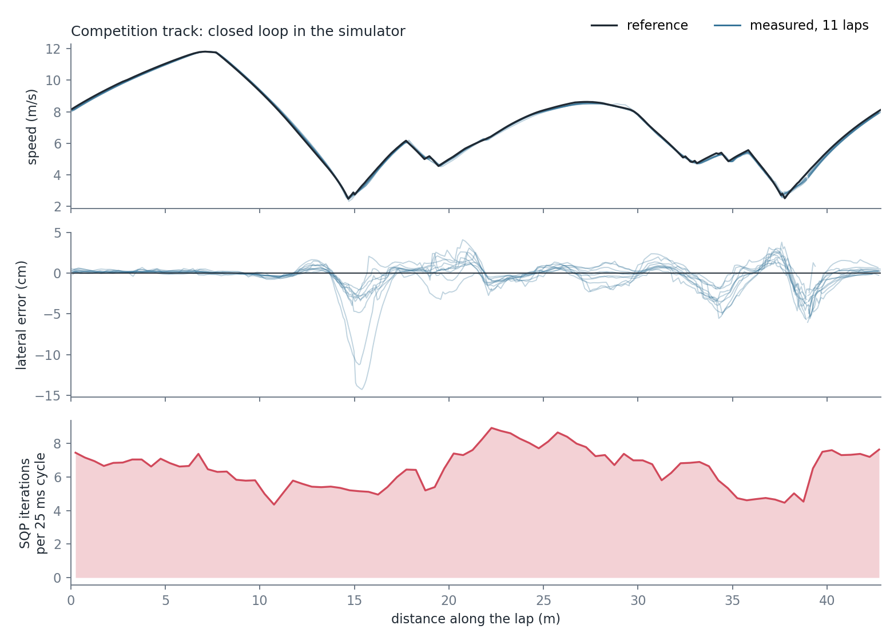
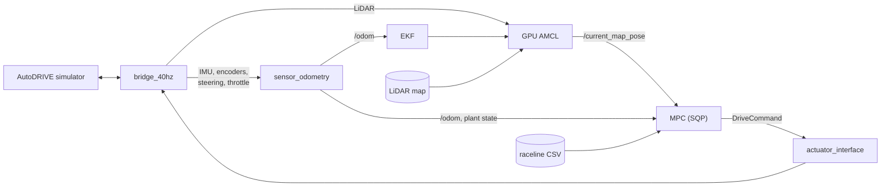

# SDU Apex Autodrive

An autonomous racing stack for the AutoDRIVE RoboRacer simulator, written for the
IROS 2026 sim-racing competition. A nonlinear MPC runs at 40 Hz on a vehicle model
derived from the simulator's own source, a GPU particle filter localizes the car on a
LiDAR map, and the racelines come from our own minimum-time optimizer.

<p align="center">
  
</p>

The stack drives the 42.8 m competition lap in about 7.0 s. The raceline peaks near 12 m/s
on the straight and slows to about 2.5 m/s at the hairpins.

## Results

The recorded Unity trials target one warm-up lap followed by ten scored laps:

| Track | Lap length | Reference lap | Mean lap | Best lap | Scored laps | Runs finished |
|---|---:|---:|---:|---:|---:|---:|
| Practice | 26.6 m | 4.800 s | 4.856 s | 4.828 s | 49 | 4 of 5 |
| Competition | 42.8 m | 6.925 s | 7.020 s | 6.949 s | 61 | 5 of 8 |

The reference lap is the duration of the optimized raceline. Lap counts, means and best times
come from [docs/data/lap_times.csv](docs/data/lap_times.csv) and include the completed laps of
runs that stopped early; a finished run reaches lap 11. The raw trial logs are large and stay
local. [docs/mpc.md](docs/mpc.md) describes the controller's known limits.

<p align="center">
  
</p>

On the competition track the measured speed follows the reference through the whole lap.
The lateral error is mostly within 5 cm; the largest excursions are at the two hairpins
(14.8 m and 37.8 m), and the worst single lap reaches 14 cm at the first one. Averaged over
laps, the solver completes 4 to 9 SQP iterations per 25 ms cycle depending on track position.

<p align="center">
  
</p>

The figures are drawn by [docs/figures/make_figures.py](docs/figures/make_figures.py)
from the checked-in racelines, maps and run-log extracts in [docs/data/](docs/data/).

## How it works

The [MPC controller](f1tenth_mpc/) uses sequential quadratic programming to choose
30 pairs of steering target and throttle every 25 ms. It integrates each candidate
through a C++ vehicle model derived from the simulator source, including tires,
suspension, motor torque and the steering rack. Forward-mode automatic differentiation
supplies derivatives; OpenMP workers evaluate stages and an Eigen-based solver handles
the QP. Exact model rollouts check cost reduction and constraint violations before
acceptance. Publication separately checks the horizon against wall and speed bounds,
including the competition profile's far-stage wall tolerance. The cycle budget is 22 ms.
The model approximates Unity's physics; closed-loop trials test how well it drives.

The [localization package](f1tenth_localization/) builds odometry from the permitted
sensors (IMU, wheel encoders, steering and throttle feedback) and propagates the same
vehicle model. An EKF filters the odometry, and a CUDA particle filter (AMCL) corrects
the pose against the LiDAR map. The MPC reads the estimated plant state and map pose.

The [raceline optimizer](raceline_optimizer/) extracts the track from an occupancy map,
builds geometric starting points and searches for a minimum-time lap with IPOPT over
the same plant model. A driving reference can constrain travel direction. The output
contains the raceline and the steering and throttle that realize it in the model.
See [docs/raceline-optimization.md](docs/raceline-optimization.md).

The [LiDAR follow-the-gap controller](f1tenth_control/) drives a slow lap of an
unknown track while SLAM builds the map that the optimizer starts from.

The [simulator integration package](sdu_apex_autodrive/) wraps the official AutoDRIVE
bridge with a 40 Hz request loop and converts MPC commands into simulator inputs.
A static guard, [tools/verify_runtime_topic_policy.py](tools/verify_runtime_topic_policy.py), checks that
the autonomous launch avoids restricted inputs.



## Repository layout

| Path | Contents |
|---|---|
| `f1tenth_mpc/` | The controller, its tests, and `util/` with solver benchmarks and frozen-problem tools |
| `f1tenth_localization/` | Source-derived odometry, EKF, CUDA AMCL |
| `f1tenth_planning/` | Maps and racelines for the practice and competition tracks |
| `f1tenth_control/` | LiDAR follow-the-gap controller used for mapping |
| `sdu_apex_autodrive/` | Simulator bridge, actuator interface, launch files |
| `sdu_apex_msgs/` | `DriveCommand` and `UnityPlantState` messages |
| `raceline_optimizer/` | Offline minimum-time raceline optimizer (Python, CasADi, IPOPT) |
| `tools/` | Trial runner, log analysis, raceline and mapping tooling, topic-policy check |
| `docs/` | Design notes, figures and the data behind them |
| `third_party/` | Excerpt of the AutoDRIVE Unity project used as the plant reference |

## Build and run

Requirements: Docker with NVIDIA GPU support and a GPU supported by the CUDA
localization build. On x86-64, the default MPC build also requires x86-64-v3 CPU
support. `tools/sim/start_simulator.sh` pulls the AutoDRIVE RoboRacer simulator
images on first use.

```bash
# competition controller image: defaults to x86-64-v3 on x86-64
tools/build_competition.sh
tools/run_competition.sh
# in another terminal, start the IROS simulator for the competition map
SDU_APEX_SIM_TRACK=iros tools/sim/start_simulator.sh

# supervised closed-loop trial against the simulator; stops on a collision, an MPC
# fault or when the lap count is reached, and writes everything to live_runs/RUN_ID
tools/sim/run_trial.sh practice my_first_run
tools/sim/run_trial.sh competition my_second_run

# lap times and solver statistics of a finished trial
source /opt/ros/humble/setup.bash
source install/setup.bash
tools/analysis/summarize_trial.py live_runs/my_first_run
```

The summary needs the built workspace messages and NumPy in the ROS environment.
Stop the competition controller and simulator with `docker stop sdu_apex_autodrive_competition sdu_apex_sim_iros`
before starting a supervised trial. The trial runner owns its controller and simulator.
Trial options, CPU isolation and outputs are in [docs/trials.md](docs/trials.md).

## Examples

Check the autonomous launch for restricted inputs:

```console
$ python3 tools/verify_runtime_topic_policy.py
runtime topic policy: PASS
```

Compare MPC weights over several closed-loop runs. The spec names a track, the number of
laps and the parameter sets to try. Recorded attempts, including failed runs,
are skipped when the sweep restarts:

```bash
cat > sweep.json <<'JSON'
{"name": "weight_u", "track": "practice", "laps": 11, "runs_per_candidate": 4,
 "interleave": true,
 "candidates": [{"name": "u40", "params": {"weight_u": 40.0}},
                {"name": "u50", "params": {"weight_u": 50.0}}]}
JSON
tools/analysis/sweep_mpc.py run sweep.json
tools/analysis/sweep_mpc.py report sweep.json
```

Generate a raceline for a new map (needs the optimizer environment from
[raceline_optimizer/README.md](raceline_optimizer/README.md)); run it again to resume,
add `--watch` to follow progress:

```bash
tools/raceline/run_raceline_campaign.sh my_track.pgm my_track.yaml
```

Benchmark the solver on frozen problems captured from a trial, without the simulator
([f1tenth_mpc/util/README.md](f1tenth_mpc/util/README.md) explains capture and export):

```bash
build/mpc_util/mpc_sqp_bench solve live_runs/cases/competition_000112.case 8
```

Redraw the figures above from the checked-in extracts (requires NumPy and Matplotlib):

```bash
python3 docs/figures/make_figures.py
```

With the original run directories available, add `--collect live_runs` to refresh
the extracts before drawing. That option overwrites the CSV files in `docs/data/`.

## Tests

```bash
# C++ (MPC and localization); the CPU build skips the CUDA AMCL
source /opt/ros/humble/setup.bash
colcon build --merge-install --packages-up-to f1tenth_localization f1tenth_mpc \
  --cmake-args -DBUILD_GPU_AMCL=OFF
ctest --test-dir build/f1tenth_mpc --output-on-failure
ctest --test-dir build/f1tenth_localization --output-on-failure

# Python tools and the raceline optimizer
python3 -m pytest tools/tests
cd raceline_optimizer && python3 -m pytest
```

CI runs the C++ build and tests on ROS 2 Humble, plus the optimizer tests and
documentation-link check ([.github/workflows/ci.yml](.github/workflows/ci.yml)).

## Documentation

| Page | Topic |
|---|---|
| [docs/architecture.md](docs/architecture.md) | Packages, data flow, topic policy |
| [docs/mpc.md](docs/mpc.md) | MPC formulation, solver, publication checks, timing, limits |
| [docs/localization.md](docs/localization.md) | Odometry, EKF, AMCL |
| [docs/raceline-optimization.md](docs/raceline-optimization.md) | Minimum-time optimizer, outputs and validation |
| [docs/mapping.md](docs/mapping.md) | Mapping an unknown track |
| [docs/trials.md](docs/trials.md) | Running and evaluating simulator trials |
| [docs/development.md](docs/development.md) | Build flags, benchmarks, diagnostics, tests |
