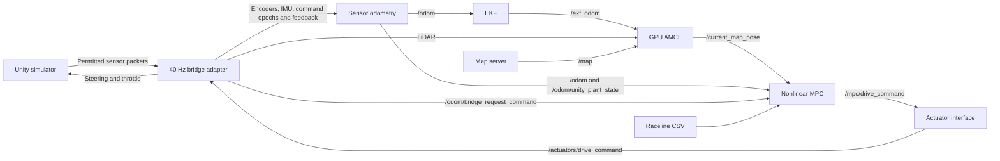

# Runtime architecture

The stack estimates motion from Unity's permitted sensors, localizes on a LiDAR map and sends steering and throttle commands through a 40 Hz bridge.

## Packages and launch

| Package | Responsibility |
|---|---|
| [sdu_apex_autodrive](../sdu_apex_autodrive/) | Bridge adapter, actuator interface and ROS launch |
| [f1tenth_localization](../f1tenth_localization/) | Sensor odometry, typed plant state, EKF and CUDA AMCL |
| [f1tenth_mpc](../f1tenth_mpc/) | Steering/throttle MPC, source plant, reference parsing and publication checks |
| [f1tenth_planning](../f1tenth_planning/) | Maps and practice/competition reference trajectories |
| [f1tenth_control](../f1tenth_control/) | LiDAR follow-the-gap controller for mapping |
| [sdu_apex_msgs](../sdu_apex_msgs/) | Typed ROS interfaces, including `DriveCommand` and `UnityPlantState` |
| [raceline_optimizer](../raceline_optimizer/) | Offline source-model raceline optimization |

[docker/competition_entrypoint.sh](../docker/competition_entrypoint.sh) starts
[competition.launch.py](../sdu_apex_autodrive/launch/competition.launch.py).
[controller.launch.py](../sdu_apex_autodrive/launch/controller.launch.py) starts the
development controller/localization path with selectable maps, trajectories and overlays.
The competition launch disables reset inputs, development packet timing and MPC diagnostics.
It always loads `mpc_competition.yaml`; only the development launch selects
the MPC profile from the map filename.

## Runtime data flow



| Node | Consumes | Publishes |
|---|---|---|
| `autodrive_bridge_40hz` | Unity packets; atomic `/actuators/drive_command`; permitted steering/throttle command endpoints | Sensor topics below; `/odom/bridge_request_command`; `/odom/bridge_actuator_feedback` |
| `sensor_odometry_node` | Encoders, IMU, request commands and associated actuator feedback | `/odom`; `/odom/unity_plant_state` |
| `ekf_localization_node` | `/odom` | `/ekf_odom`; `/ekf_pose` |
| `map_server` | Selected occupancy-map YAML/image | `/map` |
| `gpu_amcl_cpp_node` | LiDAR, `/ekf_odom`, `/map`, selected raceline for startup/direction gates | `/current_map_pose` |
| `MpcControllerNode` | `/odom`, `/odom/unity_plant_state`, `/current_map_pose`, `/odom/bridge_request_command`, raceline CSV | `/mpc/drive_command`; optional development `/mpc/diagnostics` |
| `actuator_interface` | `/mpc/drive_command` | Atomic `/actuators/drive_command`; `/autodrive/roboracer_1/steering_command`; `/autodrive/roboracer_1/throttle_command` |

The actuator interface checks finite values and command bounds, divides steering
by its 0.5235987756 rad limit, and forwards normalized throttle in `[0.001, 1]`.
The bridge consumes the validated steering/throttle pair atomically. Zero throttle
selects Unity's brake branch and is outside the MPC decision interval.
See [localization](localization.md) and [MPC](mpc.md) for state and solver details.

## Topic policy

Permitted sensor inputs used by the autonomous stack are:

- `/autodrive/roboracer_1/imu`
- `/autodrive/roboracer_1/left_encoder` and `/autodrive/roboracer_1/right_encoder`
- `/autodrive/roboracer_1/lidar`
- `/autodrive/roboracer_1/steering` and `/autodrive/roboracer_1/throttle`

Team-derived state includes `/odom`, `/odom/unity_plant_state`, `/ekf_odom` and
`/current_map_pose`. The typed plant state comes from team odometry, not Unity truth.
Autonomous nodes must not subscribe to simulator ground-truth pose/odometry,
collision or lap/result topics, reset commands, or transform topics and aliases.
The bridge wrapper disables the upstream reset subscription. Competition localization
uses direct state topics with TF publication disabled.

Development recorders and supervisors can observe restricted telemetry for stopping
and offline scoring. They do not feed it back into autonomous control. Run the guard
before launching; its `--live` option also audits a running competition graph:

```bash
python3 tools/verify_runtime_topic_policy.py
python3 tools/verify_runtime_topic_policy.py --live
```

## Bridge timing

The [bridge adapter](../sdu_apex_autodrive/sdu_apex_autodrive/bridge_40hz.py)
uses a 0.025 s request interval. A ROS publication timer alone does not
establish fresh sensor data or a Unity physics timestamp.

The adapter imports the installed upstream decoder without editing its files.
It paces outgoing `Bridge` requests, associates responses by FIFO, stamps packet
messages with the associated local request time, omits camera processing and
receives commands on a dedicated listener. Local request time is an association
convention; FIFO does not establish exact command application at each physics step.
Topic checks establish the permitted-input boundary, not organizer approval of
every adapter behavior.

## Development tools

The [trial runner](trials.md) manages the simulator, recorder and collision/lap watcher.
Scripts in [tools/analysis](../tools/analysis/) decode bags, score runs and write manifests;
[tools/sim/watch_sim_run.sh](../tools/sim/watch_sim_run.sh) stops supervised runs.
[Development](development.md) covers frozen-problem diagnostics in
[f1tenth_mpc/util](../f1tenth_mpc/util/).
Optimizer workspaces, caches and outputs are generated artifacts; their source
and export contract are described in [raceline optimization](raceline-optimization.md).
