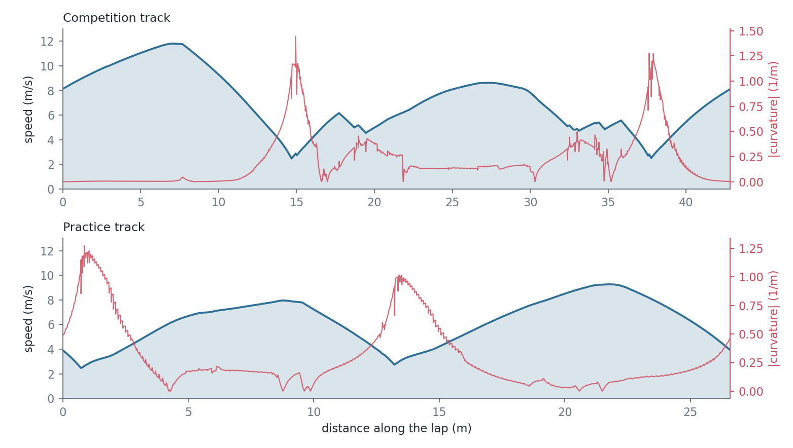

# Nonlinear MPC

The controller chooses steering and throttle over 30 stages at 40 Hz using a vehicle model derived from Unity source.

## Problem formulation

Each decision is a steering target and normalized throttle in `[0.001, 1]`,
held for 25 ms; the horizon is 750 ms. Every candidate runs through
[unity_source_plant.cpp](../f1tenth_mpc/src/unity_source_plant.cpp).
The QP proposes controls through a local model; exact rollouts decide acceptance.
Zero throttle selects Unity's brake branch and is outside the decision interval.

The tracking cost penalizes lateral and heading error, speed error, lateral velocity,
yaw rate, and steering state and queued commands. Other terms penalize command
effort, command changes and grip loss. Curvature multiplies the overspeed weight
by `1 + g |kappa|` and divides the underspeed weight by that form of factor.
The two gains are `overspeed_curvature_gain_m` and `underspeed_curvature_gain_m`.
Lateral and heading weights use
`1 + g_y |kappa|` and `1 + g_psi |kappa|`, controlled by
`lateral_curvature_gain_m` and `heading_curvature_gain_m`; zero gives uniform weight.
Eight corridor inequalities check the four body corners against both walls.
Other constraints bound commands and publication speed, including the permitted
brief reverse motion during braking.

Both [practice](../f1tenth_mpc/config/mpc_practice.yaml) and
[competition](../f1tenth_mpc/config/mpc_competition.yaml) profiles allow 16 SQP
iterations, use `derivative_force_substeps: 1` and a 22 ms cycle budget.
The iteration limit is a ceiling; deadlines can stop a solve earlier.
State estimation is described in [localization](localization.md).

## Grip and slip cost

At each 1 ms tick the plant reports per-wheel loss beyond the source tire peaks:

| Axis | Loss beyond the peak; zero below it |
|---|---|
| Longitudinal | `loss_x = 1 - abs(response_x) / 0.9` for `abs(slip_x) > 0.15` |
| Front lateral | `loss_y = 1 - abs(response_y) / 1.0` for `abs(slip_y) > 0.01` |
| Rear lateral | `loss_y = abs(slip_y) / 0.01 - 1` for `abs(slip_y) > 0.01` |

For each wheel, `L = loss_x² + loss_y²` is maximized over the stage's 25 ticks
and costs `weight_grip_loss * max(0, L - grip_loss_tolerance²)²`.
The rear penalty measures slip beyond the peak directly because lateral force
falls only 3% at twice peak slip. Practice uses tolerance 0.36: with no longitudinal
loss, the penalty starts at rear slip 0.0136. Competition uses tolerance 0.2;
both profiles use weight 200.

The measurements on this page come from local benchmark and trial logs that are too large to track. The reference speeds can be checked in the raceline CSVs; the lap summary and plotted traces are in [data](data/).

The reported rear breakaway threshold is slip 0.02. Typical practice apex slip
of 0.0118 incurs no penalty, while 0.02 does. Reference exits with wheelspin
show longitudinal loss near 0.36.

The reported median front lateral slip is 0.024 at the practice hairpin and
0.045–0.051 at competition progress 33–35 m, where force remains near 80% of
peak. One failure combines lateral slip 0.075, longitudinal slip −0.48 and
hairpin-entry overspeed of +0.5 m/s.
`weight_u_overspeed: 40` penalizes that carried overspeed.

## One control cycle

`mpc_cycle_solve` in [mpc_cycle.cpp](../f1tenth_mpc/src/mpc_cycle.cpp) does the following:

1. It shifts the issued plan by the elapsed command stages and integrates from the synchronized state.
2. It calls `source_sqp::solve`, which computes stage sensitivities in parallel, builds a local model, solves a convex QP and checks the candidate with an exact rollout. It repeats until the iteration limit or request-window deadline.
3. The same solve tries to restore an infeasible starting horizon while accounting for racing cost. If the starting plan violates physical bounds, it also tries a seed that retains steering and uses minimum positive throttle.
4. It integrates and validates the publication candidate independently. If the horizon fails, it issues no candidate and restores the issued solver memory.

[mpc_source_sqp.cpp](../f1tenth_mpc/src/mpc_source_sqp.cpp) keeps the best exactly
verified iterate. Its local model uses adjoint-weighted stage Hessians in
seven core coordinates.
It reuses them across cycles and refreshes the first stage and invalid stages.
Wheel-slip costs use convex epigraphs of first-order residuals so the QP can see
a crossed slip limit before acceptance. The solver adds elastic grip rows as
needed, starting with reach 0.05. First-order rows cover all corners and speed bounds.
[mpc_source_qp.cpp](../f1tenth_mpc/src/mpc_source_qp.cpp) uses exact L1 penalties
for violated wall/speed rows so restoration remains feasible in the QP.
The solver adds rows and resolves until every omitted row is satisfied.

## Prediction accuracy and restoration

The racing-step accuracy target is
`abs(predicted_reduction - exact_reduction) / cost_before <= 0.05`.
Each round tries radii `r`, `r/2`, `r/4`, `r/8` concurrently. It selects the trial
with the best exact decrease among those meeting the accuracy target. The solver
uses measured cost error to add a rank-one curvature correction
(`add_measurement`). If a wall is closer than the linear model predicts, it adds
a secant row. It tries two corrections before shrinking the radius. The next radius is
`step * sqrt(0.5 * tolerance / error)`, capped at fourfold growth.

If rounds or time expire without an accurate step, the best exact decrease can
be accepted with `accurate = false`. The trial summary counts these fallbacks.
Reported accepted racing-step errors have median 1.5% and p99 4.7%; live
fallbacks account for 0.06–0.21%. Over 145 × 300 source closed-loop cycles,
99.9% meet the 5% target. The reported analysis attributes missing curvature to
combined-slip saturation and tire spline knots. The median full-step/half-step
error ratio is 3.9, versus 4 for a quadratic. Without correction, first trials
meet 5% in 58% of cases and have p99 error 36%.

Restoration uses racing cost plus the configured exact L1 constraint penalty;
a small gain in reserve cannot offset a large increase in tracking or slip cost.
Once restoration reaches physical feasibility, it rejects steps that lose it.
If no trial in the first round is feasible, it takes the best verified merit decrease.

In the reported comparison of 95 frozen cases from failure windows and profiles,
waiting for feasibility consumes all four rounds in 52/55 restoration iterations
(21 ms versus 4 ms per round). Accepting in the first round leaves 83/83
feasible-start cases identical. At equal iteration count, cost and margin, it
makes 3–4 more of the 12 infeasible-start cases feasible. Restoration that
accounts for racing cost reaches feasibility in two iterations in this comparison;
minimum-norm restoration needs twelve.

If the resulting plan still fails publication bounds, the solve restarts once
from a floor-throttle warm plan with an empty curvature cache. The seed is
integrated even at deadline expiry and can itself supply a publishable plan.
A plan missing only the clearance reserve can publish without that restart.
The reported competition comparison records restarts in 2/22,842 cycles, about
0.01%. It completes 7/8 eleven-lap runs, with mean lap times of 7.02–7.09 s
and 0.2% deferrals.
An unscorable seed returns `invalid_model` with `seed_failure`.
If a preview endpoint lies within `4e-10 m` of a track knot spaced at 6 mm,
the bound evaluation uses its continuous value without adding an extra slope.

## Publication and state gaps

The competition solve targets a 0.05 m reserve; practice targets 0.02 m.
Publication independently checks all 30 stages against zero reserve,
speed bounds and the command box.
Competition permits a far-stage wall tolerance ramp: zero through stage 12,
then linearly up to `publication_far_tolerance_m: 0.10` at stage 30.
The tolerance allows a predicted wall violation at distant stages; it does not
add physical space. Subsequent cycles replan before executing those stages.
In the reported set of 26 failing runs, the first violations occur at stage 15+
in 20 runs and stage 20+ in 16 runs, by 4–6 cm. Repeated rejection grows heading
error from 0.02 to 0.3 rad within ten cycles. A comparison with the tolerance
completes 4/6 eleven-lap runs versus 2/5 without it; the sample is small.

Publication waits for confirmation of the preceding bridge request. A missed
window defers publication within the 22 ms budget; the solver uses the window
deadline when it is earlier. During a state gap, the controller advances through
the issued plan only at confirmed epochs. It never repeats a consumed stage or
extends the validated horizon, and it applies the same publication checks.
After the stale-state grace period expires, it requires fresh state. The latency
measured for continuation does not replace the solve/publication latency estimate.

## Derivative cost and convergence

For racing, automatic differentiation uses 20 lanes: 18 physical coordinates
excluding timers, plus two controls. Positive throttle resets the sticky timers
each stage. The plant selects 20-, 21- or 28-lane kernels; lane 21 can pack
eight independent timer diagonals.
The second-order pass differentiates forward and lateral speed, yaw rate, steering
target and throttle. On the first iteration, first-order and second-order stages
share a parallel pass, with second-order stages scheduled first.

`derivative_force_substeps` accepts 0–5; 0 retains five force substeps per 1 ms
tick below 5 m/s and one above. Derivative lanes are single precision; primal
values and branch decisions stay double. The reported timings and errors for
one 25-tick, 20-lane stage at 3 m/s are:

| Force-substep cap | Time | `u,v,r` derivative error | Displacement derivative error |
|---|---:|---:|---:|
| 0, source schedule | 226 µs | Reference | Reference |
| 3 | 144 µs | ≤0.5% | ≤3% |
| 2 | 103 µs | ≤1.7% | ≤5% |
| 1 | 61 µs | ≤4.1% | ≤14% |

Above 5 m/s the source already uses one substep. Exact rollouts, acceptance and
publication always retain the source schedule. If capped derivatives reject every
trial, the iteration repeats once at its starting radius with the full schedule,
which remains active for that solve. This gives a coasting hairpin seed another
chance to accelerate before the radius shrinks. In the reported comparison,
single- and double-precision derivative lanes agree within `3e-5` relative
cost/control error on 29/30 frozen problems. One problem follows different
acceptance decisions and ends with 1% higher cost.

The reported KKT convergence count is 0/22,600 cycles. With a four-iteration
limit, 70% of racing cycles and 15% of hairpin cycles stop at the deadline;
the others reach the iteration cap. On 30 frozen cycles, four iterations leave
a median cost excess of 2.5% relative to 60 iterations. The first steering
command differs by a median 0.13 mrad (p90 2.7 mrad); hard starts reach
7.7× cost and a 13–39 mrad difference. Radii of 4–35 mm grow about 7% per
iteration, with 2% model error and an exact/predicted reduction ratio of 0.8–0.99.

Using tolerance 0.4 reduces the worst cost excess to 1.6× but does not correct
the worst command. Hairpin iterations 5–7 each remove about 1% of starting cost;
four iterations leave about 10 ms of budget. The reported Unity comparisons
at 4, 6 and 8 iterations average 4.84 s laps, with completion differences
within measurement noise.

## Timing and measured limits

The reported timing sample at 40 Hz with a 22 ms budget contains 35/60,871
late commands (0.057%); 0.19–0.25% of cycles defer. Rollouts stop at the solver
deadline. The sample records overruns beyond 19.6 ms in 0.028% of cycles.
Descheduled derivative workers take 13–14 ms rather than 3–4 ms, and 12 late
commands follow a finished solve with a callback delay of 3–7 ms.
Real-time thread priority is untested. [Development](development.md) covers build
timing and [trials](trials.md) covers CPU isolation and measured lap results.

With uncapped derivatives and a four-iteration limit, the reported corner
profile averages 1.6–2.1 iterations and stops at the deadline in 75% of cycles.
A 6 ms iteration spends 65% of its time on linearization, 12% on a cold-started
60-variable interior-point QP and 8% on serial model assembly; rollouts take
the remainder. Those fractions imply an overall speedup of 1.14× if QP time
is eliminated, or 1.95× if linearization becomes four times faster.

The closed competition raceline is 42.843 m long. The vehicle footprint
is 0.273 m wide, extends 0.430 m ahead of the rear axle and has a rear overhang
of 0.080 m. A reported 1 mm-grid check gives minimum reference clearance of
63.5 mm near progress 14.8 m; other minima lie near 20.1, 23.4, 29.2, 32.5
and 37.6 m. The checked-in reference reaches 11.8 m/s and a lateral acceleration
demand of 13.3 m/s².

Neither track profile uses a curvature speed envelope. Equal normalized
source-force allocation (`mu_y=1`, `mu_x=0.9*0.8`, `g=9.81 m/s²`) gives
lateral acceleration of 6.9367 m/s² and longitudinal acceleration of 4.9944 m/s².
The reported envelope comparison predicts about 8.06 s per lap and measures
8.016 s driven. Practice exceeds 6.94 m/s² for 72% of its reference lap time
and competition for 57%; their maxima are 11.2 and 13.3 m/s². The references use the source tire
curves beyond this allocation.

The reported replay of 16 runs predicts motion over 25–100 ms with forward-speed
RMSE of 0.005–0.009 m/s and yaw-rate RMSE of 0.007–0.013 rad/s. The analysis
reports no systematic speed or yaw loss at high demand that supports a global
grip or rack-lag correction. All 2,800 logged plans reach tire usage 1, and
90% of first-stage ticks saturate. Without grip reserve, state error can turn
predicted clearance into contact. One reported single-packet native closure
error of 49 mm remains unexplained.

The runtime has no hard timing guarantee. Reported simulator/bridge stalls of
about 100 ms affect all streams and can end in rejection. Continuing the issued
plan cannot recover missing measurements.
An inward tracking error of 4–5 cm can consume the inner-wall margin at the
practice hairpin or competition chicane (33–38 m). The plant retains its
piecewise source equations without smoothing. Finite trials do not establish
unlimited collision-free operation.
