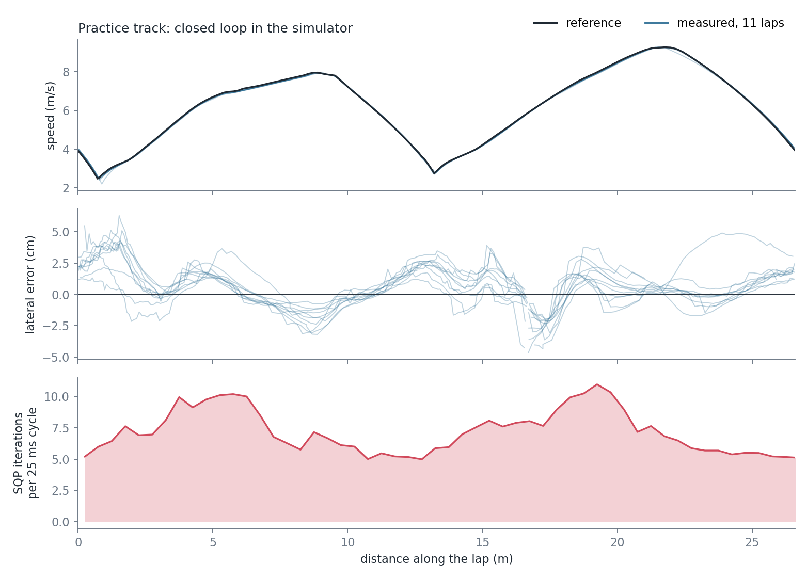
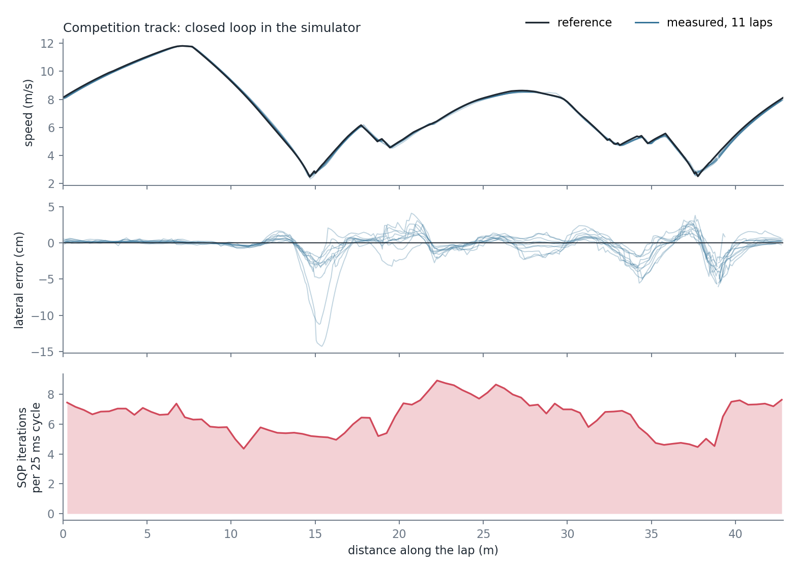
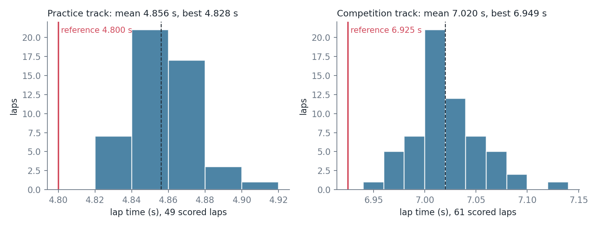

# Unity closed-loop trials

The trial runner builds the controller, drives a selected Unity track, records the run and stops it on completion or failure.

## Run a closed-loop trial

Run from the repository root with Docker available. Use a fresh `RUN_ID` each time:

```bash
tools/sim/run_trial.sh practice RUN_ID
tools/sim/run_trial.sh competition RUN_ID
```

The development controller selects one of two profiles from the map filename:

| Track | MPC parameters | Runtime reference |
|---|---|---|
| Practice | [mpc_practice.yaml](../f1tenth_mpc/config/mpc_practice.yaml) | [raceline.csv](../f1tenth_planning/trajectories/practice/raceline.csv) |
| Competition | [mpc_competition.yaml](../f1tenth_mpc/config/mpc_competition.yaml) | [raceline.csv](../f1tenth_planning/trajectories/competition/raceline.csv) |

The runner builds inside the development image and starts the controller,
recorder, Unity and watcher. It writes an ignored directory named after `RUN_ID`
and prints its location. A lock prevents two trials from sharing the simulator
and ROS domain. The watcher stops on collision, MPC fault/rejection, stall, timeout or
lap completion. The default is six total laps, including the standing-start
warm-up; use eleven for one warm-up plus ten scored laps:

```bash
SDU_APEX_TRIAL_TOTAL_LAPS=11 tools/sim/run_trial.sh competition RUN_ID
```

| Environment variable | Meaning |
|---|---|
| `SDU_APEX_TRIAL_TOTAL_LAPS` | Warm-up plus scored laps; default 6, minimum 2 |
| `SDU_APEX_TRIAL_WALL_TIMEOUT_S` | Watcher timeout; default 240 s |
| `SDU_APEX_MPC_PARAMETER_OVERLAY` | YAML overlay inside the repository |
| `SDU_APEX_TRIAL_TRAJECTORY_FILE` | Alternative repository-local raceline CSV for either track |
| `SDU_APEX_MPC_NATIVE_TUNING=true` | Compile for the host CPU |
| `SDU_APEX_MPC_LTO=true` | Enable link-time optimization |
| `SDU_APEX_MPC_HORIZON` | Compile-time 25 ms stages; default 30, supported 10–80 |
| `SDU_APEX_TRIAL_CPU_ISOLATION=false` | Disable automatic CPU partitioning |

The development build caches colcon output in Docker volumes
`sdu_apex_build_<image id>` and `sdu_apex_install_<image id>`.
Reported build times are about 1 s with unchanged source and 38 s for a
changed-source LTO build. The reported comparison finds matching cached and
uncached binaries.

Removing the selected cache volumes with `docker volume rm` forces a full rebuild. Host power settings and scheduler priorities
are unchanged.

## CPU isolation

When it detects six P-cores and four E-cores with 16 logical CPUs, the runner reserves
`0,2,4,6,8,10` for MPC, `9,11` for other ROS nodes/supervision and `12-15` for
Unity/Xvfb and recording. It applies Docker cpusets and process affinity because
the measured rootless Docker host ignores cpusets alone. On other topologies,
the runner skips this automatic partition and uses its default controller cpuset
or explicit CPU settings and overlays.

On that topology, MPC uses six Jacobian workers, bound OpenMP places, active
waiting and `GOMP_SPINCOUNT=1000000`. Explicit overlays take precedence.
Each run records its allocation in `cpu_isolation.txt`. The base MPC profiles
specify eight workers when this trial override does not apply.

The reported worker comparison makes a cold first iteration about 16% faster
with six workers than four; a seventh on a hyperthread sibling is slower.
The eight-iteration stress-profile results are below.

| Isolation | Solves above 21 ms per 1,000 | Maximum solve | Deferred cycles |
|---|---:|---:|---:|
| Disabled | 11.4 | 39.2 ms | 25 / 2,362 |
| Enabled | 3.1 | 23.1 ms | 5 / 2,599 |

These reported results apply to the measured host and provide no hard timing guarantee.

## Read a run

Set `run_dir` to the printed trial directory. In a sourced ROS environment with
the built workspace messages available, run:

```bash
python3 tools/analysis/summarize_trial.py "$run_dir" --keep-export "$run_dir/analysis"
python3 tools/analysis/evaluate_mpc_bag.py "$run_dir/run"
```

The summary reports outcome, deferrals, solve/publication timing and QP accuracy.
`watcher.log` contains `LAP_TIME lap=N time_s=T` beside lap counts; lap 1 is
warm-up. Distinguish zero completed laps from missing evidence. The generated
run directory retains the bag, map/trajectory copies, actual base/overlay parameters,
build/controller/simulator/recorder/watcher logs and sealed `run_manifest.json`.
Analysis can add a versioned report, cycle-detail CSV and full diagnostics JSONL.
[Development](development.md) covers diagnostic exports and state-gap analysis.

The state-gap analysis covers 198 runs.

In that analysis, a `375 ms` stale-state warning appears during shutdown in both
successful and failed runs. The p99 recorder-to-control latency is 5 ms, and
the maximum callback-to-sync latency is 0.1 ms. Completed runs have no control-cycle
gap above 80 ms; the worst is 57 ms. Gaps of 99–128 ms affect map pose, odometry,
plant state, IMU, encoders and Unity truth together, compared with the nominal
25 ms interval. These gaps concentrate at practice progress 12.8–15.7 m and can
produce heading error above 100 mrad.

The reported competition gaps last 0.2–0.3 s, or 8–12 continuations, and precede
an early-stage rejection in about one run in six. Classify simulator/bridge
stalls separately from controller failures, and count shutdown collisions separately.

## Measured driving results

The lap summary comes from [lap_times.csv](data/lap_times.csv).
It includes completed laps from runs that stop early. A finished run reaches
lap 11, after one warm-up and ten scored laps.

| Track | Reference lap | Mean lap | Best lap | Scored laps | Runs finished |
|---|---:|---:|---:|---:|---:|
| Practice | 4.800 s | 4.856 s | 4.828 s | 49 | 4 of 5 |
| Competition | 6.925 s | 7.020 s | 6.949 s | 61 | 5 of 8 |





The plots use the checked-in traces under [data](data/). The comparisons below
report separate campaigns and settings; their run logs are local and not tracked, so they cannot be recomputed from this lap-time extract.

### Reported tuning comparisons

- With force-substep cap 1 and six workers, practice completes 5/5 eleven-lap
  runs. The 50 scored laps average 4.854 s, with a maximum of 5.071 s and one
  lap above 4.9 s. Below 5.5 m/s, the solver averages 6.27 iterations. With
  uncapped derivatives and four workers, it averages 4.00 iterations, completes
  4/5 runs and records a mean lap of 4.846 s.
- Without the rear-slip term, practice first-apex slip has median 0.0170.
  Slip exceeds 0.02 on 14/30 passes, and 6/30 runs fail, including 5 at the
  first hairpin. With the term, median slip is 0.0117: 0/8 passes exceed
  0.015, and 0/54 later passes exceed 0.0138. There are 1/12 failed runs
  and 0/12 first-pass failures; the mean lap is 4.838 s. A source line with
  a 9 cm margin and 0.015 slip cap certifies at 4.85 s but does not reduce
  the measured failure rate or apex scatter. Margins of 58–80 mm do not
  certify at that pace.
- With curvature gains `(0.5, 0.5)`, practice completes 5/5 runs. Mean scored
  lap times range from 4.845–4.859 s; each run's slowest lap is 4.869–4.921 s.
- In the competition heading-up measurement without a speed envelope,
  7/8 eleven-lap runs complete. The 76 scored laps average 7.018 s and all
  stay below 7.2 s, compared with the 6.925 s reference. Across 91 runs,
  21 show rejection, concentrated at progress 12–20 m and 32–40 m, mostly
  on later laps.

Two eight-run blocks with identical gains `(0.5, 0.5)` fail 1/8 and 4/8
(`p=0.28`). The reported interpretation is that blocks this small do not
separate failure rates differing by less than about threefold. Gains
`(1.0, 0.5)` produce 0/8 controller failures, compared with 5/16 at
`(0.5, 0.5)` (`p=0.13`); both average 7.02 s.

A reported 48-run Sobol screening of 18 factors estimates that raising the
clearance reserve from 0.02 to 0.09 m adds +0.089 s per lap (95% interval
+0.006 to +0.179 s). With reserves of 0.02–0.03 m, about half the runs fail
at hairpin or chicane exits. Ten runs at 0.04 m average 7.013 s without
separating its failure rate from 0.05 m. The competition profile uses 0.05 m.

With competition weights `weight_u=50` and `weight_e_y=5500`, the reported
22-run comparison averages 7.017 s, with 3 controller failures and 2 stalls.
Weights 35/4000 average 7.034 s over 24 runs, with 2 failures and 4 stalls.
The difference is 0.017 s, about two standard errors.

Among 22 first rejections, six follow state gaps at 16.4–22.1 m and 36.0 m.
The other ten hairpin failures occur at 14.3–17.5 m, and six chicane failures
at 34.1–37.5 m. [MPC](mpc.md) explains the margins and gates.

## Automatic export validation

[optimizer_mpc_validation.py](../tools/raceline/optimizer_mpc_validation.py)
watches source-certified optimizer exports only. On initial startup it queues
the latest certified reference and marks others seen; later exports enter a
serialized FIFO. Every attempt uses an immutable trajectory identified by its
SHA-256 hash,
the IROS map and eleven official laps. Failed trials require an explicit retry.

Set `workspace` to the existing optimizer output directory. Stop any managed
supervisor before running a second foreground instance:

```bash
source tools/docker_env.sh
python3 tools/raceline/optimizer_mpc_validation.py --workspace "$workspace" --once
python3 tools/raceline/optimizer_mpc_validation.py --workspace "$workspace" --watch
python3 tools/raceline/optimizer_mpc_validation.py --workspace "$workspace" --retry "$witness_id"
```

Here `witness_id` is the failed candidate's hash/prefix shown by the dashboard.
For a systemd-managed instance, set `validation_service` to its installed unit:

```bash
systemctl --user status "$validation_service"
tail -F "$workspace/mpc_validation/supervisor.log"
systemctl --user stop "$validation_service"
```

During builds, driving and analysis, the supervisor freezes the optimizer
systemd cgroup after checking its identity. It then resumes the optimizer from
its iterate. It saves a pause lease, releases it on shutdown and recovers it on
restart. If Unity, controller or recorder containers already exist, it defers
the trial. The automatic watcher defaults to 900 s and has a separate outer
watchdog; MPC startup has a 75 s watchdog. Candidate heading is checked against the
[IROS spawn reference](../f1tenth_planning/trajectories/competition/initial_raceline.csv).
Keep simulator spawn and AMCL heading consistent with that direction.

Each attempt creates a run directory. The workspace retains immutable witness
snapshots and launch logs in its validation inputs. If validation supplies an
`mpc_parameter_overlay.yaml`, the supervisor copies and hashes it and records
it with the actual base parameters. Practice-only parameters do not implicitly
apply to IROS. Builds use current source; trials do not promote a reference or
modify the optimizer's best manifest.

Analysis runs inside the controller ROS image identified by
`runtime.controller_image.local_image_id` in `run_manifest.json`. That exact
local image must exist; absence is an analysis error. Failed runs are decoded too.
Reports include official lap durations and per-lap RMS cross-track, heading
and speed errors. They also contain full-run distributions, statuses, faults,
median/p95/maximum timing, progress bins and cycle records. A freshly built
evaluator records its source-model library SHA and predicts 750 ms from logged
observer states. It uses the commands actually issued later, without applying
later state corrections. Endpoint RMSE and maximum error, maximum error over the
horizon, and paths exceeding 5 cm measure this replay. They do not evaluate an
unexecuted MPC plan. Overlapping windows are correlated. Missing analysis means
the metric is unavailable, not zero; metrics end at the first fault.

A successful attempt requires the watcher to complete without abort, the
process to return successfully, and the bag to contain ten completed scored lap
events after warm-up. The report flags missing diagnostics or laps. The
[dashboard](raceline-optimization.md#dashboard) shows lap progress and supervisor
status. Its same-origin JSON retry endpoint queues only failed, source-certified
candidates, deduplicates requests and cannot execute commands.
Pausing its display does not stop IPOPT or Unity. Completion does not establish
identity with Unity's private native solver.

## Competition image and cleanup

```bash
tools/build_competition.sh
tools/run_competition.sh
tools/sim/stop_autodrive.sh
```

The first two commands build and launch the separate competition image.
The last stops the default development controller container. [Architecture](architecture.md)
describes the competition topic restrictions.
